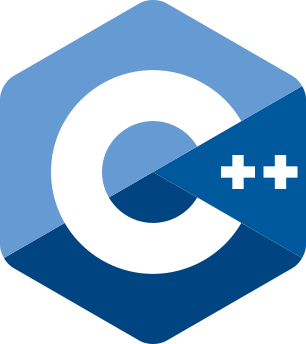
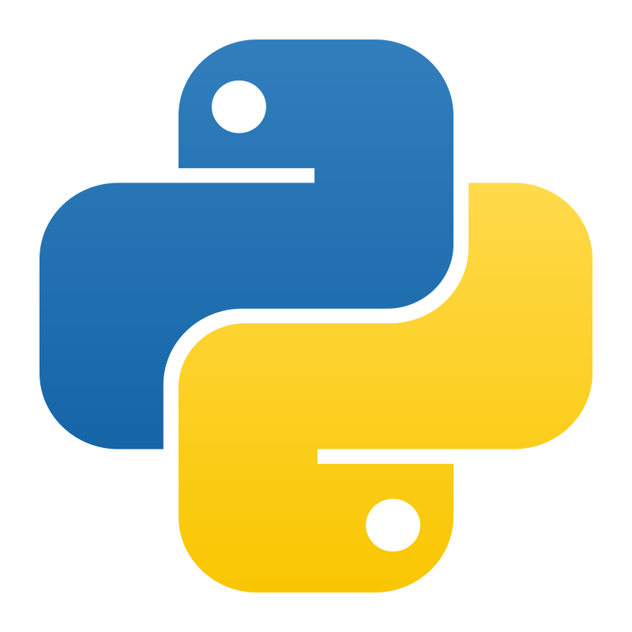
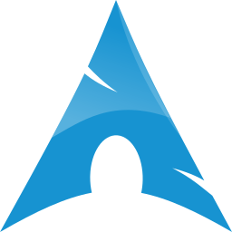
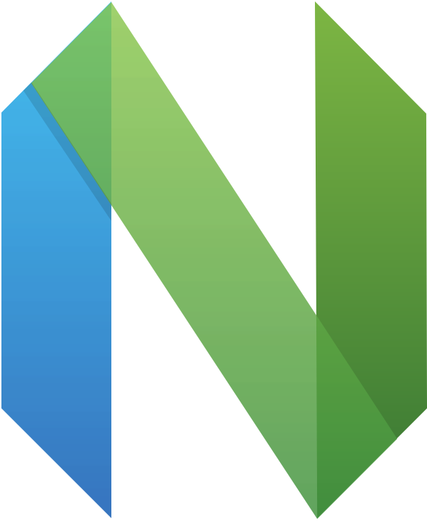

<h2 align="center">💻 Programming Languages</h2>

  
  
  

<h2 align="center">⚙️ Technologies & Tools</h2>

  
  
  

---

<h2 align="center">🏆 Competitive Programming</h2>

  
  

---

<h2 align="center">📊 GitHub Stats</h2>

  
  

  

---

<h2 align="center">🌐 Connect with Me</h2>

  
  
  
  

